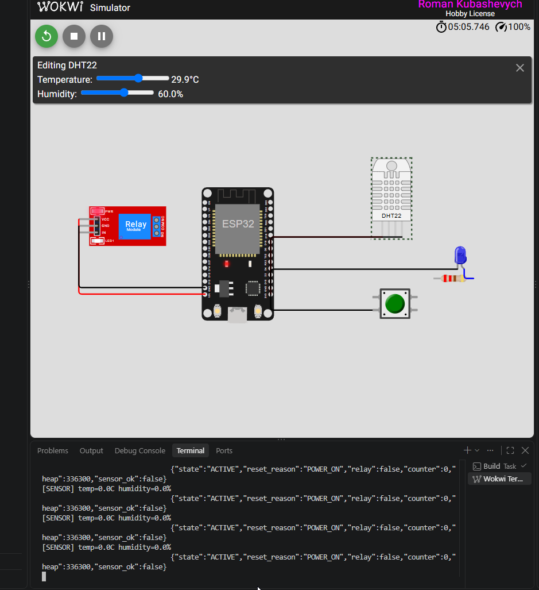

# ESP32 IoT Controller — Fault Injection, Watchdog, Sleep & NVS

**SUT:** separate ESP32 Wokwi training build with relay, DHT22, button, LED and NVS. Not the same firmware as the network-node case study.

*Simulation setup screenshot; functional outcomes are documented in the corresponding test report.*

## Test problem
Can the firmware recover from hang or sleep safely, preserve state consistently across simulated power loss, and expose failures rather than masking them?

## Test focus
Boot/reset reason, DHT22 missing-value handling, `relay on/off`, WDT hang recovery, `sleep N`, `powerloss`, and NVS counter persistence.

## Observed results
- After `hang`, task watchdog triggered a reboot and reported `INT_WDT`. Recovery returned to ACTIVE, but **relay=true** persisted when the relay had been ON before hang (repeat 2/2). Fails safe-state requirement; physical voltage across reboot was not measured.
- `sleep 3/5/6` showed a DEEPSLEEP_RESET wake path; longer requests 7/8/10 sometimes included an extra TG1WDT_SYS_RESET. Exact sleep duration and WDT timing were not independently measured; a separate source review suggested a timer scaling bug.
- Sensor repeatedly reported `temp=0.0C humidity=0.0%`, `sensor_ok=false`, without an explicit error; simulated sensor values were varied without observed effect.
- `powerloss` caused SOFTWARE_RESET and counter jumps (e.g., 3→103), suggesting interrupted-save handling issues; don't claim proven mixed-state corruption without a verified state oracle.
- Physical button press reaction remained inconclusive rather than a confirmed black-box FAIL.

## QA decision
**FAIL** for the tested training build. Separate confirmed black-box findings from source-review observations and ambiguous scenarios.

[Detailed WDT / Sleep / NVS QA report](https://docs.google.com/document/d/15COrL-vUTrdvnlFhEyEcGxBkvmDZotUFSGCyLE40-kg/edit) · [Portfolio home](../README.md)

**Skills demonstrated:** WDT fault injection, persistence/state testing, recovery oracles, safety, careful limits on simulated-time evidence.
